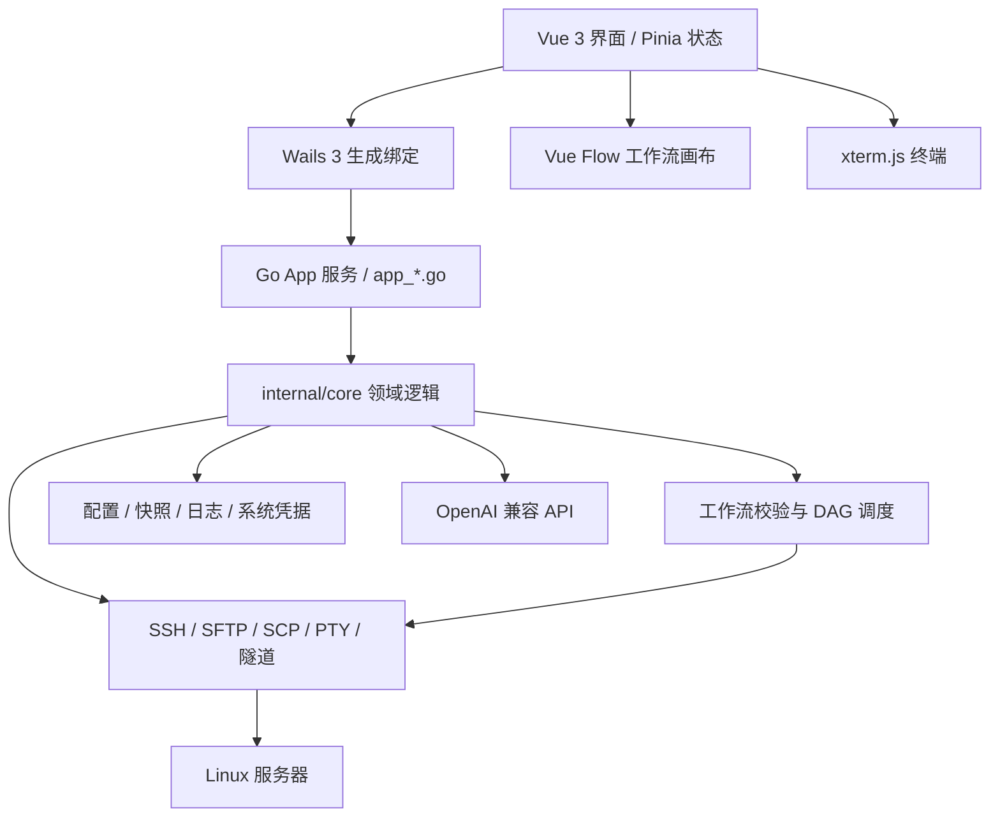

# 霆舟 ThunderShip

基于 **Go + Wails 3 + Vue 3** 的 Windows 桌面运维与部署工具。通过 SSH 连接 Linux 服务器，集中管理终端、远程文件和部署工作流。

在本机构建好程序或静态资源后，将文件与远程命令组成可视化工作流，即可完成上传、重启与检查。目标服务器无需安装专用常驻 Agent。

## 功能

| 模块 | 功能 |
| --- | --- |
| 服务器管理 | 服务器分组、搜索、密码及私钥认证、连接测试、SSH 主机指纹确认、同服务器多会话 |
| 交互终端 | xterm.js 终端、PTY 输入与窗口尺寸同步、终端标签切换、路径及本机命令历史补全 |
| 增强终端 | 按命令展示输出、耗时和退出状态；后台执行、输出复制、历史回填；支持切换到交互终端 |
| 远程文件 | 目录浏览、排序筛选、多选、复制/剪切/粘贴、新建、重命名、删除、权限调整和目录收藏 |
| 文件传输 | SFTP / SCP 上传下载、本地文件拖入与剪贴板上传、同名文件对比与跳过/覆盖、可执行权限、sudo 传输 |
| 在线编辑 | 编辑 UTF-8 文本，保留换行、BOM 和权限；保存前检查远端变化，使用临时文件与原子替换 |
| 构建物管理 | 复用本地文件或文件夹，配置远端映射，同一构建物可发布到多个目录 |
| 可视化工作流 | 拖放节点与连线，组合服务器、上传、命令、脚本及其他工作流；支持串行、并行与依赖汇合 |
| 执行记录 | 运行预检查、逐步骤输出、上传进度、执行结果、取消和历史回放 |
| 服务器监控 | Linux CPU、内存、Swap、网络、进程和磁盘信息；复用当前 SSH 连接 |
| SSH 隧道 | 本地及远程 TCP 端口转发，手动启停、连接数与错误状态展示 |
| 工作流共享 | JSON 导入导出，导入时显式关联目标服务器和本地构建物 |
| AI 辅助 | 接入 OpenAI 兼容服务，生成工作流草稿或终端命令建议；支持主动引用命令输出和截图 |
| 桌面体验 | 深浅主题、自定义标题栏、可调整面板、单实例启动 |

AI 生成内容需要人工确认；命令建议不会自动执行。未配置 AI 服务时，仍可使用终端、文件管理与手动工作流。

## 语言与技术栈

| 层次 | 语言 / 技术 | 用途 |
| --- | --- | --- |
| 桌面应用与后端 | Go 1.26、Wails 3.0.0 | 应用生命周期、原生窗口、文件对话框、Go 服务绑定 |
| 前端 | TypeScript、Vue 3、Vite 7 | 页面与交互、类型检查、前端构建 |
| UI 与状态 | Vuetify 3、Pinia | 组件、主题及工作区状态 |
| 工作流画布 | Vue Flow | 节点、连线、缩放与布局 |
| 终端 | xterm.js | 终端渲染与交互输入 |
| 网络与传输 | golang.org/x/crypto/ssh、pkg/sftp | SSH 会话、SFTP、SCP、端口转发 |
| 本地存储 | JSON、JSONL、Windows 凭据管理器 | 配置、运行记录与密码/API Key |
| 构建与检查 | PowerShell、JavaScript、Go test | Windows 构建、前端回归脚本与后端测试 |

当前构建脚本面向 **Windows x64**，受管服务器以 **Linux** 为主。Windows 运行端需要 WebView2 Runtime；其他桌面平台尚未验证。

## 架构



- **界面层**负责表单、工作流编辑、终端展示和交互状态，通过生成的绑定调用 Go 服务。
- **应用层**位于 `app_*.go`，负责资源操作、连接生命周期、桌面 API 与领域逻辑的协调。
- **核心层**位于 `internal/core`，实现配置校验、工作流调度、SSH 会话、文件传输、存储和 AI 协议。执行器依赖会话接口，可使用测试会话验证调度逻辑。
- **运行方式**为本地桌面应用直接连接服务器；工作流配置和执行记录保存在本机。

## 目录职责

```text
ThunderShip/
├─ main.go                # Wails 3 应用入口
├─ app_*.go               # Go 应用服务及对应测试
├─ internal/core/         # 核心逻辑与测试
├─ frontend/
│  ├─ src/                # Vue / TypeScript 源码与界面资产
│  ├─ public/             # 静态资源与第三方许可
│  ├─ bindings/           # 自动生成的 Go 绑定，不提交
│  ├─ dist/               # Vite 构建结果，不提交
│  └─ node_modules/       # npm 依赖，不提交
├─ build/                 # 可复现的打包输入，不放运行数据
│  ├─ appicon.png         # 应用图标源文件
│  ├─ config.yml          # Wails 开发配置
│  └─ windows/            # Windows 图标、版本信息、manifest
├─ scripts/               # 可复用构建辅助与回归检查脚本
├─ dist/                  # 生成的 ThunderShip.exe，不提交
├─ local/                 # 本机工作资料，不提交
│  ├─ qa/                 # 测试数据、截图、测试产物和元数据
│  ├─ logs/               # 本机调试日志
│  ├─ backups/            # 历史配置与恢复备份
│  ├─ analysis/           # 本机分析资料
│  ├─ docs/               # 开发计划、AI 工作文档
│  └─ cache/              # 临时依赖包及缓存
├─ build.ps1              # Windows 构建与开发入口
└─ Taskfile.yml           # Wails 任务入口
```

**目录约定：**`build/` 只维护打包输入；可执行程序输出到根目录 `dist/`；测试或人工检查生成的文件放入 `local/` 对应子目录。`scripts/` 保留可重复使用的检查程序，单次调查脚本放到 `local/`。

`.gitignore` 排除构建结果、依赖、运行数据、日志、备份、私钥、环境变量文件、AI 工具配置和开发计划。AI 功能本身的实现代码及测试属于项目源码，正常提交。

## 从源码运行

### 准备环境

- Windows x64 与 WebView2 Runtime。
- Go 1.26 系列 SDK。`build.ps1` 会从 `%USERPROFILE%\sdk\go1.26.*` 中选择最高版本，与 GoLand 的 SDK 布局一致；安装 CLI 或手动执行 Go 命令前，请将对应 SDK 的 `bin` 加入当前终端 `PATH`。
- Node.js 22.12+ 与 npm。
- 固定版本的 Wails CLI：

```powershell
go install github.com/wailsapp/wails/v3/cmd/wails3@v3.0.0
```

### 构建与开发

```powershell
git clone https://github.com/muyi911/ThunderShip.git
cd ThunderShip

.\build.ps1          # 构建 dist/ThunderShip.exe
.\build.ps1 -Dev     # 启动桌面开发模式及 Vite 热更新
```

首次构建会使用锁文件安装前端依赖，生成 Go / TypeScript 绑定，执行前端类型检查与打包，再生成 Windows 资源及程序。构建前请保存草稿并退出正在运行的 ThunderShip。脚本使用系统默认 Go 缓存，不在项目内创建 `.gocache`。

Wails CLI 加入 `PATH` 后，也可以运行 `wails3 build`。仅运行 Vite 提供界面预览；SSH、文件管理等后端能力需要桌面窗口。

### 检查

在使用项目 Go SDK 的终端中运行：

```powershell
go test ./...
go vet ./...
go test -race ./... # Windows 需要可用的 C 编译工具链

# 先构建一次，准备依赖及生成绑定，再运行前端检查
Get-ChildItem scripts -Filter '*check.mjs' | ForEach-Object {
    node $_.FullName
    if ($LASTEXITCODE -ne 0) { throw "检查失败：$($_.Name)" }
}
```

检查覆盖工作流调度、文件发布、连接与隧道、终端交互、资源编辑和导入导出等逻辑。自动化检查不等同于真实服务器部署验证。

## 基本使用

1. **添加服务器**：填写地址、用户和认证方式，测试连接并核对 SSH 指纹，再保存。
2. **管理构建物**：选择本地文件或文件夹，设置目标路径；多个工作流可引用同一构建物。
3. **编辑工作流**：连接“服务器 → 上传 → 命令/脚本”等节点，按需要设置分支、依赖和并发限制。
4. **检查并运行**：确认目标服务器、远端路径和执行内容后启动，在执行面板查看进度及结果。
5. **日常运维**：打开服务器连接，使用终端、远程文件、指标面板或 SSH 隧道。
6. **可选 AI 辅助**：在设置中填写兼容接口、模型及 API Key；检查生成内容后手动应用。

## 数据与凭据

- 配置默认位于 `%APPDATA%\ThunderShip\config.json`；运行快照、文件副本及 JSONL 日志存放在同级 `runs/`，WebView 缓存位于 `webview/`。
- Windows 密码、私钥口令与 API Key 保存在系统凭据管理器中，不写入配置 JSON。配置仍包含服务器地址、本地路径和 AI 服务地址，不应上传到仓库。
- 界面偏好与本机命令历史保存在 WebView 存储中。运行副本和日志暂不自动清理。
- 测试时可将 `SHELL_WORKFLOW_DATA` 设置为项目内 `local/qa/` 下的独立目录；该变量只覆盖数据目录，系统凭据仍使用当前 Windows 用户的凭据存储。
- AI 请求会发送用户选择的上下文、引用输出或截图到所配置的服务。请在发送前确认内容。

## 执行边界

- 上传使用同目录临时文件、大小检查与原子替换；需要远端 SFTP 支持对应重命名能力。SCP 模式仍通过 SFTP 完成检查与发布，并要求服务器提供 `scp`。
- 原子性以单个文件为单位，多文件或多服务器部署没有事务回滚。部分失败时，应查看已完成步骤和文件记录。
- 取消或断线不能保证远端脚本停止，无法确认的执行结果不会自动重放。
- 命令行模式中的命令使用独立 Shell；需要共享变量、目录或控制流时使用脚本模式。
- 当前不包含服务器端构建、任意脚本自动回滚、断点续传、SOCKS5 动态代理或 AI 自主部署。

## 第三方许可

引用实现与字体的许可说明见 [THIRD_PARTY_NOTICES.md](THIRD_PARTY_NOTICES.md)。Go 与 npm 依赖保留各自的许可。
